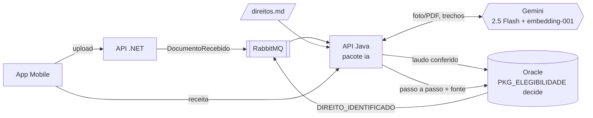

# 🤖 Direito Fácil — IA (Disruptive Architectures: IoT, IoB & Generative IA)

Entrega da disciplina **Disruptive Architectures** para a Global Solution 2026/2 (CitizenTech) do grupo **Direito Fácil**: a funcionalidade de inteligência artificial que lê o laudo médico do cidadão, lê a receita e escreve, com RAG, o passo a passo para pedir cada direito.

> [!IMPORTANT]
> **O código-fonte da IA está no repositório da API Java do grupo**, e não neste repositório:
> **https://github.com/Global-Solution-Direito-Facil/gs2-Java-Advanced**
>
> A IA roda dentro da API Java (Spring Boot + Spring AI), que está publicada no Render e é consumida pelo app Mobile. O código **não foi copiado para cá de propósito**: assim a IA documentada aqui é exatamente a mesma que está em produção, sem duas versões diferentes. Os arquivos da IA estão listados em [Código-fonte da IA](#-código-fonte-da-ia-no-repositório-java).

Este repositório é a **entrega da disciplina de IA**: explica a funcionalidade, a IA generativa usada, o aprofundamento técnico (RAG e Visão Computacional), os dados, a arquitetura e as limitações da IA da API.

> **Princípio da solução: a regra decide, a IA explica.** Quem decide se a pessoa tem direito é uma função PL/SQL determinística no Oracle. A IA só transcreve documentos e escreve orientações a partir de uma base conferida pelo grupo, citando a fonte.

---

# 📹 Demonstração

- **API publicada (Swagger):** https://direitofacil-java.onrender.com/swagger-ui/index.html (plano gratuito: a primeira chamada pode demorar um minuto)
- **🎬 Vídeo explicando a IA:** https://youtu.be/zfzvJxJb8S4

---

# 👥 Integrantes da Equipe

| Nome                               | RM     | Turma  | GitHub                                            | LinkedIn                                                        |
| ---------------------------------- | ------ | ------ | ------------------------------------------------- | --------------------------------------------------------------- |
| **Alexander Dennis Isidro Mamani** | 565554 | 2TDSPG | [alex-isidro](https://github.com/alex-isidro)     | [LinkedIn](https://www.linkedin.com/in/alexander-isidro/)       |
| **Gabriel Neris Losano**           | 564093 | 2TDSPG | [GNLosano](https://github.com/GNLosano)           | [LinkedIn](https://www.linkedin.com/in/gabriellosano/)          |
| **João Vítor Biribilli Ravelli**   | 565594 | 2TDSPG | [biribillidev](https://github.com/biribillidev)   | —                                                               |
| **Kelson Zhang**                   | 563748 | 2TDSPG | [KelsonZh0](https://github.com/KelsonZh0)         | [LinkedIn](https://www.linkedin.com/in/kelson-zhang-211456323/) |
| **Pietro Paranhos Wilhelm**        | 561378 | 2TDSPG | [PietroWilhelm](https://github.com/PietroWilhelm) | [LinkedIn](https://www.linkedin.com/in/pietrowilhelm/)          |

---

# ✅ Requisitos da disciplina

| # | Requisito | Onde está |
|---|---|---|
| 01 | Aplicação ao problema: funcionalidade de IA, público beneficiado e contribuição | seção [A funcionalidade](#-01--a-funcionalidade-de-ia-e-o-público) |
| 02 | IA generativa no fluxo da aplicação, por API ou local | seção [IA generativa no fluxo](#-02--ia-generativa-no-fluxo-da-aplicação); código no pacote [`ia`](https://github.com/Global-Solution-Direito-Facil/gs2-Java-Advanced/tree/main/src/main/java/br/com/fiap/direitofacil/ia) da API Java |
| 03 | Aprofundamento: RAG básico e/ou ML/DL/Visão, com justificativa | seção [Aprofundamento](#-03--aprofundamento-técnico-rag-básico--visão-computacional): **RAG básico** (passo a passo) e **Visão Computacional** com modelo pré-treinado (leitura do laudo e da receita) |
| 04 | Dados e arquitetura: fontes, preparação e fluxo entre aplicação, modelos e serviços | seção 04 (Dados e arquitetura), [`docs/arquitetura.md`](docs/arquitetura.md) (diagramas) e [`docs/dados.md`](docs/dados.md) |
| 06 | Organização e uso responsável: código, instruções, credenciais, dados pessoais, limitações | seções [Código-fonte da IA](#-código-fonte-da-ia-no-repositório-java) (na API Java), [Como executar](#-como-executar) e [Uso responsável](#-06--uso-responsável-e-limitações), e [`docs/limitacoes.md`](docs/limitacoes.md) |

## 📚 Documentação complementar (pasta `docs/`)

O README resume cada requisito; o detalhe completo está nestes três arquivos:

| Arquivo | Requisito | O que tem |
|---|---|---|
| [`docs/arquitetura.md`](docs/arquitetura.md) | 04 | diagramas em Mermaid: visão geral (App → .NET → RabbitMQ → Java → Gemini → Oracle), sequência da leitura do laudo, pipeline do RAG, fluxo da receita; o que cada classe do pacote `ia` faz; segurança e privacidade |
| [`docs/dados.md`](docs/dados.md) | 04 | fontes dos dados da IA (catálogo de direitos, base do RAG, elenco do Farmácia Popular, laudo e receita, salário mínimo); preparação da base do RAG (escrita, divisão, embeddings, consulta) e do laudo/receita (prompt, contrato de saída, conferência); como os dados são protegidos |
| [`docs/limitacoes.md`](docs/limitacoes.md) | 06 | tabela de limitações (efeito, mitigação atual, próximo passo); o que a IA nunca faz; uso responsável |

---

# 🎯 01 — A funcionalidade de IA e o público

**O problema.** Muita família tem um laudo médico na gaveta e não sabe que ele dá acesso a uma série de direitos federais: BPC/LOAS, passe livre, isenção de IPI, CIPTEA, cotas, meia-entrada, tarifa social... Quem mais precisa (mãe de criança autista, pessoa idosa de baixa renda, pessoa com deficiência) é quem menos consegue ler a lei, saber o que pedir e onde.

**O público.** Cidadãos com laudo médico (pessoas com deficiência, com TEA, idosos) e seus responsáveis; e o **assistente social do CRAS**, que acompanha dezenas de famílias e não tem tempo de digitar laudo por laudo. ODS 3 (saúde e bem-estar), 10 (redução das desigualdades) e 11 (cidades e comunidades sustentáveis).

**O que a IA faz pelo cidadão** (três pontos do fluxo, nunca um chat solto):

| Função | O que entra | O que sai | Benefício | Classe na API Java |
|---|---|---|---|---|
| **Ler o laudo** | foto ou PDF do laudo enviado pelo app | CID, condição, tipo da condição e data, em JSON | a pessoa não digita nada; o laudo gravado dispara a regra que abre os casos (direitos `ELEGIVEL`/`POSSIVEL`) | [`IaLaudoService`](https://github.com/Global-Solution-Direito-Facil/gs2-Java-Advanced/blob/main/src/main/java/br/com/fiap/direitofacil/ia/IaLaudoService.java), [`LaudoLido`](https://github.com/Global-Solution-Direito-Facil/gs2-Java-Advanced/blob/main/src/main/java/br/com/fiap/direitofacil/ia/LaudoLido.java) |
| **Escrever o passo a passo** | o direito do caso (nome, órgão, base legal) + trechos da base de conhecimento | 3 a 7 passos em linguagem simples, com a fonte legal | a pessoa sabe o que fazer, onde e com quais documentos, sem ler a lei | [`IaOrientacaoService`](https://github.com/Global-Solution-Direito-Facil/gs2-Java-Advanced/blob/main/src/main/java/br/com/fiap/direitofacil/ia/IaOrientacaoService.java), [`IaBaseConhecimento`](https://github.com/Global-Solution-Direito-Facil/gs2-Java-Advanced/blob/main/src/main/java/br/com/fiap/direitofacil/ia/IaBaseConhecimento.java), [`OrientacaoGerada`](https://github.com/Global-Solution-Direito-Facil/gs2-Java-Advanced/blob/main/src/main/java/br/com/fiap/direitofacil/ia/OrientacaoGerada.java) |
| **Ler a receita** | foto da receita | lista de remédios (nome, princípio ativo se escrito, dosagem) para a pessoa conferir | depois da conferência, a tabela do Farmácia Popular diz o que é gratuito | [`IaReceitaService`](https://github.com/Global-Solution-Direito-Facil/gs2-Java-Advanced/blob/main/src/main/java/br/com/fiap/direitofacil/ia/IaReceitaService.java), [`ReceitaLida`](https://github.com/Global-Solution-Direito-Facil/gs2-Java-Advanced/blob/main/src/main/java/br/com/fiap/direitofacil/ia/ReceitaLida.java) |

A chamada multimodal compartilhada pelas duas leituras está em [`IaLeitorDocumento`](https://github.com/Global-Solution-Direito-Facil/gs2-Java-Advanced/blob/main/src/main/java/br/com/fiap/direitofacil/ia/IaLeitorDocumento.java).

**O que a IA não faz:** não decide se a pessoa tem direito (PL/SQL decide), não diz se o remédio é gratuito (tabela decide), não escreve a fonte (vem do trecho usado) e não grava nada sem a conferência do Java.

---

# 🧠 02 — IA generativa no fluxo da aplicação

A IA usa **Spring AI 2.0.1** com o **Google Gemini**, por API:

| Uso | Modelo | Recurso do Spring AI | Quando roda |
|---|---|---|---|
| Ler laudo e receita | `gemini-2.5-flash` | chat **multimodal** (`.media(...)`) + **saída estruturada** (`.entity(Record.class)`) | evento `DocumentoRecebido` (laudo) e `POST /api/v1/receitas/extracao` (receita) |
| Passo a passo | `gemini-2.5-flash` | **RAG**: `EmbeddingModel` + `SimpleVectorStore` + saída estruturada | evento `DIREITO_IDENTIFICADO` e `POST /api/v1/casos/{id}/orientacao/gerar` |
| Embeddings da base | `gemini-embedding-001` | `VectorStore.add` / `similaritySearch` | na primeira consulta |

**Por que API, e por que o Gemini.** (1) A leitura do laudo exige um modelo de visão de grande porte; um modelo local capaz de ler manuscrito e PDF em português não roda no plano gratuito do Render onde a API está publicada. (2) O Gemini 2.5 Flash tem entrada multimodal nativa (imagem e PDF), saída estruturada, custo baixo e um plano gratuito que serviu para desenvolver. (3) O mesmo cliente serve chat e embeddings, com uma única chave. A troca de provedor é uma mudança de starter e de propriedades do Spring AI; prompts, records e conferência continuam iguais.

**Configuração que importa** ([`config/IaConfig.java`](https://github.com/Global-Solution-Direito-Facil/gs2-Java-Advanced/blob/main/src/main/java/br/com/fiap/direitofacil/config/IaConfig.java) e [`application.properties`](https://github.com/Global-Solution-Direito-Facil/gs2-Java-Advanced/blob/main/src/main/resources/application.properties)): temperatura **0** (transcrição, não criação); chave **opcional** (sem `GEMINI_API_KEY` a API sobe e só a IA responde 503); arquivos aceitos PDF, JPEG e PNG; 60 s por chamada; `@Retryable` para falha transitória.

A chamada de leitura, como está em `IaLeitorDocumento`:

```java
T lido = chatClient.prompt()
        .system(promptSistema)        // o que transcrever e o que é proibido
        .user(u -> u.text(pedido)
                .media(MimeType.valueOf(arquivo.tipoMidia()), new ByteArrayResource(arquivo.conteudo())))
        .call()
        .entity(formato);             // LaudoLido.class ou ReceitaLida.class
```

Os três prompts de sistema são as constantes `PROMPT_SISTEMA` de `IaLaudoService`, `IaReceitaService` e `IaOrientacaoService`. O que cada um manda e proíbe:

| Função | O que a IA deve fazer | O que é proibido |
|---|---|---|
| Laudo | transcrever CID, condição, tipo da condição e data como estão escritos | deduzir ou completar dado que não está no laudo; opinar sobre direitos, benefícios ou tratamento |
| Receita | listar os remédios na ordem da receita, com nome e dosagem como estão escritos | inventar remédio ou dosagem; sugerir troca; opinar sobre o tratamento |
| Passo a passo | escrever de 3 a 7 passos curtos, em linguagem simples, usando só os trechos da base | acrescentar regra, valor, prazo, endereço, telefone ou site que não esteja nos trechos; dizer se a pessoa tem direito |

---

# 🔬 03 — Aprofundamento técnico: RAG básico + Visão Computacional

## RAG básico (passo a passo do caso)

```text
caso aberto → pergunta "Como pedir {direito}. Órgão: {órgão}. Base legal: {base}."
   → embeddings (gemini-embedding-001) → similaritySearch top-3 no SimpleVectorStore
   → se algum trecho tem o código do direito, fica só ele (filtro determinístico)
   → prompt: DIREITO / ÓRGÃO / BASE LEGAL / TRECHOS → gemini-2.5-flash → {encontrada, passos[]}
   → conferência (3..7 passos, limites das colunas) → grava passo a passo + fonte DOS TRECHOS
```

- **Base de conhecimento**: [`direitos.md`](https://github.com/Global-Solution-Direito-Facil/gs2-Java-Advanced/blob/main/src/main/resources/conhecimento/direitos.md), um texto por direito do catálogo (20), com `Código:` e `Fonte:`. Um teste automatizado da API (`IaBaseConhecimentoTest`) garante que todo direito do banco tem texto.
- **Preparação** (`IaBaseConhecimento`): divisão nos títulos `# `; cada direito vira um `Document` com código, fonte e título nos metadados. Sem chunking fino: a base é pequena e cada texto é uma unidade de sentido.
- **Por que RAG e não só prompt**: sem a base o modelo escreve de memória, misturando regras, valores desatualizados e leis que não existem. Com a base, ele só pode usar os trechos, e a fonte citada é a do trecho realmente usado (a IA não tem como citar uma lei que não existe).
- **Por que o filtro pelo código** (`IaOrientacaoService.trechosDoDireito`): direitos parecidos (BPC do idoso × BPC da PcD, credencial de estacionamento do idoso × da PcD) têm embeddings próximos. O filtro garante que só o trecho certo entra.
- **Falha fechada**: se os trechos não tratam do direito, o modelo devolve `encontrada = false` e **nada é gravado**; o app mostra a base legal.

## Visão Computacional com modelo pré-treinado (laudo e receita)

- A leitura do laudo e da receita é um problema de **visão + extração estruturada**: foto de celular, PDF escaneado, manuscrito, documento de lado. Em vez de treinar um OCR próprio (sem dados rotulados reais, por LGPD) ou encadear OCR + regex (quebra no manuscrito e nas variações de layout), usamos um **modelo de visão e linguagem pré-treinado** (Gemini 2.5 Flash multimodal) com **saída estruturada**: o modelo devolve JSON no esquema de um `record` Java.
- **Justificativa**: o modelo pré-treinado já resolve o OCR, o layout e a interpretação ("Diagnóstico: ... CID-10: F84.0") em uma chamada, com robustez a inclinação, ruído e baixa resolução. O custo é depender de API externa e não ter controle fino sobre o erro, e por isso toda leitura passa por uma **conferência determinística em Java** (`LaudoLido.paraRequest`, `ReceitaLida.paraResponse`) antes de chegar ao banco.
- **Classificação embutida**: além de transcrever, o modelo classifica o `tipoCondicao` (`TEA`, `DEF_FISICA`, `DEF_VISUAL`, `DEF_AUDITIVA`, `DEF_INTELECTUAL`, `DEF_MULTIPLA`, `OUTRA`). É o único dado da IA que entra na regra, e um tipo não reconhecido vira `OUTRA`, que não conta como deficiência: na dúvida, nenhum direito é aberto por engano.

**Por que não ML/DL próprio**: a Global Solution tem 15 dias, não há dataset real rotulado (laudo é dado sensível) e um modelo próprio de OCR/classificação teria qualidade muito inferior ao pré-treinado. O aprofundamento está em **integrar** o modelo pré-treinado com segurança (contrato de saída, conferência, falha fechada).

---

# 🏗️ 04 — Dados e arquitetura

Diagramas completos (visão geral, sequência da leitura do laudo, pipeline do RAG, receita) em [`docs/arquitetura.md`](docs/arquitetura.md). Fontes e preparação dos dados em [`docs/dados.md`](docs/dados.md).



| Dado | Fonte | Preparação |
|---|---|---|
| Catálogo de 20 direitos (nome, órgão, base legal, critérios) | leis federais e canais oficiais, conferidos pelo grupo | tabelas `T_DF_DIREITO` / `T_DF_CRITERIO_DIREITO` (Flyway V3) |
| Base de conhecimento do RAG | texto do grupo a partir da lei e das cartilhas oficiais de cada órgão | `direitos.md` → um `Document` por direito → embeddings → vector store em memória |
| Laudo / receita | documento do cidadão, enviado pelo app | sem pré-processamento de imagem; prompt + contrato de saída + conferência pós-modelo |
| Elenco do Farmácia Popular (41 itens) | elenco oficial | tabela `T_DF_MEDICAMENTO_FP` |

---

# 🔒 06 — Uso responsável e limitações

- **Credenciais**: nenhuma neste repositório nem na API. A chave do Gemini vem só da variável de ambiente `GEMINI_API_KEY`; na API ela é opcional (sem ela tudo funciona menos a IA).
- **Dados pessoais**: nenhum dado real de cidadão está neste repositório; os usuários de demonstração da API são fictícios. Em produção, o passo a passo não envia nenhum dado da pessoa ao modelo; nas leituras só o arquivo vai, sem nome de conta nem CPF, e o Java não guarda o arquivo. Laudo é dado sensível de saúde (LGPD): finalidade específica, minimização e a pessoa controla o envio.
- **Falha fechada em todo lugar**: documento que não é laudo, laudo sem data ou com data futura, trechos que não tratam do direito, IA fora do ar: nada é gravado, e o gestor tem o caminho manual.
- **Limitações explícitas** (detalhe em [`docs/limitacoes.md`](docs/limitacoes.md)): dependência de API externa e do limite do plano gratuito; visão não é OCR certificado (manuscrito real e foto ruim erram mais); a classificação do tipo da condição é um julgamento simplificado (erra para menos, nunca para mais); a IA transcreve "como está escrito", inclusive erros do laudo; a base do RAG é pequena e escrita pelo grupo (orientação correta em relação à base, não necessariamente à lei de hoje); não determinismo residual entre execuções.

---

# 📦 Código-fonte da IA (no repositório Java)

Todo o código da IA está em [gs2-Java-Advanced](https://github.com/Global-Solution-Direito-Facil/gs2-Java-Advanced). Caminhos a partir de `src/main/java/br/com/fiap/direitofacil/`:

| Arquivo | O que faz |
|---|---|
| [`config/IaConfig.java`](https://github.com/Global-Solution-Direito-Facil/gs2-Java-Advanced/blob/main/src/main/java/br/com/fiap/direitofacil/config/IaConfig.java) | cliente do Gemini (chave opcional, timeout de 60 s), `ChatClient` e o `SimpleVectorStore` em memória |
| [`ia/IaLeitorDocumento.java`](https://github.com/Global-Solution-Direito-Facil/gs2-Java-Advanced/blob/main/src/main/java/br/com/fiap/direitofacil/ia/IaLeitorDocumento.java) | chamada multimodal (foto/PDF → JSON) usada pelas duas leituras |
| [`ia/IaLaudoService.java`](https://github.com/Global-Solution-Direito-Facil/gs2-Java-Advanced/blob/main/src/main/java/br/com/fiap/direitofacil/ia/IaLaudoService.java) + [`LaudoLido.java`](https://github.com/Global-Solution-Direito-Facil/gs2-Java-Advanced/blob/main/src/main/java/br/com/fiap/direitofacil/ia/LaudoLido.java) | prompt da leitura do laudo e conferência antes de gravar |
| [`ia/IaReceitaService.java`](https://github.com/Global-Solution-Direito-Facil/gs2-Java-Advanced/blob/main/src/main/java/br/com/fiap/direitofacil/ia/IaReceitaService.java) + [`ReceitaLida.java`](https://github.com/Global-Solution-Direito-Facil/gs2-Java-Advanced/blob/main/src/main/java/br/com/fiap/direitofacil/ia/ReceitaLida.java) | prompt da leitura da receita e conferência |
| [`ia/IaBaseConhecimento.java`](https://github.com/Global-Solution-Direito-Facil/gs2-Java-Advanced/blob/main/src/main/java/br/com/fiap/direitofacil/ia/IaBaseConhecimento.java) | divide o `direitos.md`, gera os embeddings e indexa no vector store (RAG) |
| [`ia/IaOrientacaoService.java`](https://github.com/Global-Solution-Direito-Facil/gs2-Java-Advanced/blob/main/src/main/java/br/com/fiap/direitofacil/ia/IaOrientacaoService.java) + [`OrientacaoGerada.java`](https://github.com/Global-Solution-Direito-Facil/gs2-Java-Advanced/blob/main/src/main/java/br/com/fiap/direitofacil/ia/OrientacaoGerada.java) | busca os trechos, filtra pelo código do direito, gera e confere o passo a passo |
| [`ia/IaLeituraException.java`](https://github.com/Global-Solution-Direito-Facil/gs2-Java-Advanced/blob/main/src/main/java/br/com/fiap/direitofacil/ia/IaLeituraException.java) | falha da IA → 503 (IA fora do ar) ou 422 (documento não lido), sem gravar nada |
| [`resources/conhecimento/direitos.md`](https://github.com/Global-Solution-Direito-Facil/gs2-Java-Advanced/blob/main/src/main/resources/conhecimento/direitos.md) | base de conhecimento do RAG (20 direitos, com fonte) |
| [`resources/application.properties`](https://github.com/Global-Solution-Direito-Facil/gs2-Java-Advanced/blob/main/src/main/resources/application.properties) | modelos (`gemini-2.5-flash`, `gemini-embedding-001`), temperatura 0 e a chave lida de `GEMINI_API_KEY` (nunca escrita no código) |
| `src/test/java/.../ia/*Test.java` | 6 testes da IA que rodam sem Gemini (conferências, base completa, falha fechada) |

As dependências (`spring-ai-starter-model-google-genai`, `spring-ai-vector-store`) estão no [`pom.xml`](https://github.com/Global-Solution-Direito-Facil/gs2-Java-Advanced/blob/main/pom.xml) da API.

---

# 🚀 Como executar

A IA roda dentro da API Java. Instruções completas (JDK 25, Oracle, RabbitMQ, variáveis de ambiente, usuários de demonstração) no README do repositório [gs2-Java-Advanced](https://github.com/Global-Solution-Direito-Facil/gs2-Java-Advanced#-como-executar-o-projeto-do-zero). O essencial:

```powershell
$env:GEMINI_API_KEY="sua-chave"        # Google AI Studio; nunca no código
```

```bash
./mvnw spring-boot:run                 # no clone da API Java (Windows: mvnw.cmd)
```

## Ver a IA funcionando

- **Na API publicada**, sem instalar nada: no [Swagger](https://direitofacil-java.onrender.com/swagger-ui/index.html), faça login em `POST /api/v1/auth/login` com `ana.almeida@email.com` / `Senha@123`, clique em **Authorize**, pegue um caso em `GET /api/v1/casos/me` e chame `POST /api/v1/casos/{id}/orientacao/gerar`: o passo a passo com a fonte é gerado pelo RAG descrito aqui.
- **Leitura da receita**: `POST /api/v1/receitas/extracao` com o id de um documento enviado pelo app (passa pela API .NET).
- **Leitura do laudo**: acontece sozinha quando o app envia o laudo (evento `DocumentoRecebido` no RabbitMQ). Sem a .NET, o gestor registra o laudo em `POST /api/v1/laudos`.
- **Testes da IA sem Gemini**, na API: `./mvnw test` roda `IaOrientacaoServiceTest`, `IaReceitaServiceTest`, `LaudoLidoTest`, `OrientacaoGeradaTest`, `ReceitaLidaTest` e `IaBaseConhecimentoTest`.

---

# 📁 Estrutura do repositório

```text
DireitoFacil-IA/
├── README.md                    este arquivo
├── identificacao.txt            RM, nome e turma dos integrantes e o link do repositório (o .txt do Portal)
├── docs/
│   ├── arquitetura.md           diagramas: visão geral, laudo, RAG, receita; classes da API por função
│   ├── dados.md                 fontes e preparação dos dados
│   └── limitacoes.md            limitações e uso responsável
```

Código da IA: pacote `ia` da [API Java](https://github.com/Global-Solution-Direito-Facil/gs2-Java-Advanced).

# 🧰 Tecnologias da IA

Java 25 · Spring Boot 4.1.2 · Spring AI 2.0.1 (`spring-ai-starter-model-google-genai`, embeddings, `spring-ai-vector-store`) · Google Gemini 2.5 Flash e gemini-embedding-001 · saída estruturada em `record` · `SimpleVectorStore`. Em volta: Oracle + PL/SQL, RabbitMQ, Spring Security + JWT, Flyway.

---

# 📝 Declaração de uso de IA generativa

| Ferramenta | Para quê |
|---|---|
| **Claude (Anthropic)** | apoio em tarefas pequenas (tirar dúvidas, explicar erros, revisar textos) e na escrita deste README e nos ajustes da pasta `docs/` |


---

# 📌 Repositórios do grupo

- IA (este): https://github.com/Global-Solution-Direito-Facil/DireitoFacil-IA
- API Java (código da IA): https://github.com/Global-Solution-Direito-Facil/gs2-Java-Advanced
- Banco de dados (Oracle, PL/SQL e MongoDB): https://github.com/Global-Solution-Direito-Facil/DireitoFacil-DB
- API .NET (envio de documentos): https://github.com/Global-Solution-Direito-Facil/DiretoFacil
- App Mobile: https://github.com/Global-Solution-Direito-Facil/DireitoFacil-Mobile
