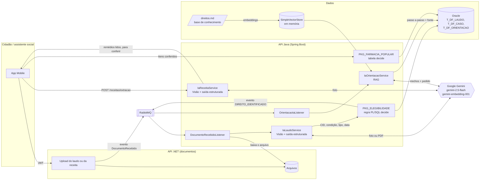
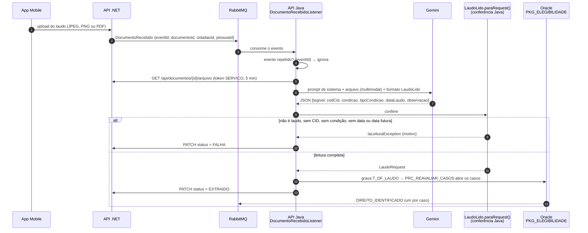
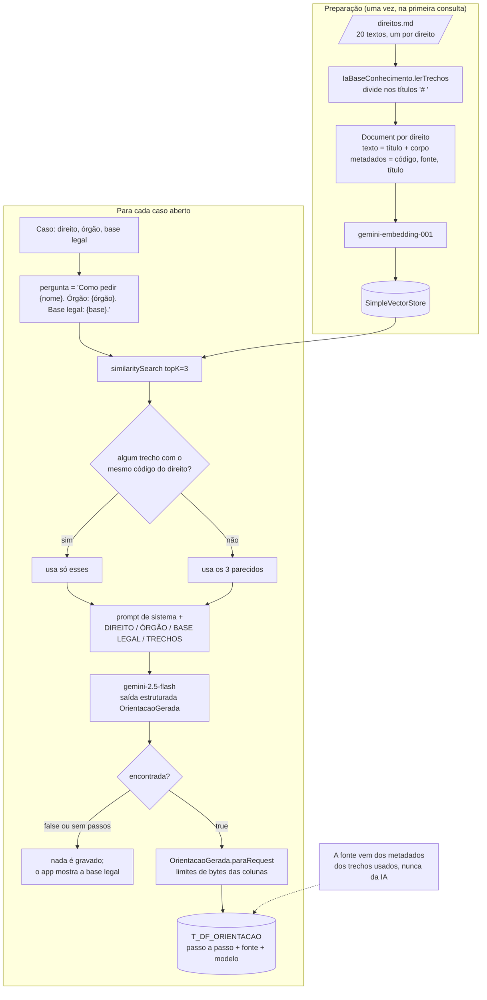
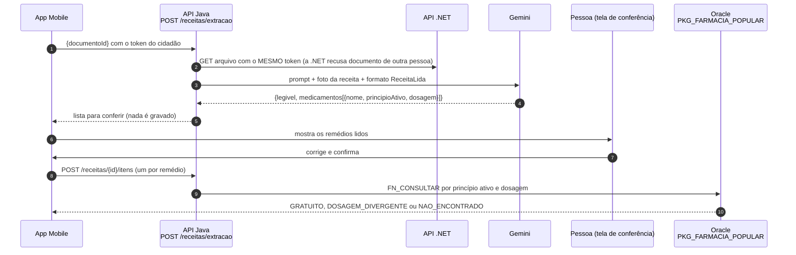

# Arquitetura da IA do Direito Fácil

> Complemento do [README](../README.md). Os diagramas estão em Mermaid e são renderizados pelo GitHub.

## 1. Visão geral: onde a IA entra na solução

A solução CitizenTech do grupo tem quatro partes: o **app Mobile**, a **API .NET** (upload e guarda dos documentos), a **API Java** (regra de negócio, Oracle, RabbitMQ e a IA) e o **Oracle** (tabelas `T_DF_*` e pacotes PL/SQL). A IA vive inteira dentro da API Java, no pacote `br.com.fiap.direitofacil.ia`, e entra em três pontos do caminho do cidadão.

**Princípio: a regra decide, a IA explica.** Em nenhum dos três pontos o modelo decide se a pessoa tem direito ou se o remédio é gratuito. Quem decide é o PL/SQL, de forma determinística e auditável, a partir dos dados que a IA transcreveu e que o Java conferiu.

## 2. Fluxo 1: leitura do laudo (Visão Computacional + saída estruturada)

Decisões de projeto:

- **Saída estruturada (`.entity(LaudoLido.class)`)**: o modelo devolve JSON no formato de um `record` Java, e não texto livre. Assim o Java confere campo a campo antes de gravar.
- **Temperatura 0**: a mesma entrada tende a dar a mesma resposta, o que importa em transcrição de documento.
- **O único dado da IA que entra na regra é `tipoCondicao`**; um tipo não reconhecido vira `OUTRA`, que não conta como deficiência. Na dúvida, nenhum direito é aberto por engano.
- **Falha fechada**: documento que não é laudo, laudo sem data ou com data no futuro não é gravado. É melhor pedir outro arquivo do que abrir um caso indevido.

## 3. Fluxo 2: passo a passo com RAG

Por que RAG, e por que este RAG:

- **Sem RAG** o modelo responderia de memória, misturando regras de estados diferentes, valores desatualizados e leis inventadas. **Com RAG** ele só pode escrever a partir de um texto que o grupo conferiu, e a fonte citada é a do trecho realmente usado.
- **Um trecho por direito, sem chunking fino**: a base é pequena (20 textos curtos) e cada texto é uma unidade de sentido completa. Cortar em pedaços menores só aumentaria a chance de misturar direitos.
- **Filtro pelo código** depois da busca semântica: direitos parecidos (BPC do idoso e BPC da pessoa com deficiência; credencial de estacionamento do idoso e da PcD) têm embeddings próximos. O código garante que o trecho certo entra sozinho.
- **Vector store em memória** (`SimpleVectorStore`): o Oracle 19c da FIAP não tem tipo `VECTOR`, e 20 vetores cabem na memória. A indexação acontece na primeira consulta, não na subida, para a API subir mesmo sem a chave.

## 4. Fluxo 3: leitura da receita (Farmácia Popular)

Aqui a IA tem o papel mais restrito dos três: **transcrever para a pessoa conferir**. O princípio ativo só é preenchido se estiver escrito; nomes comerciais ficam sem princípio ativo e a pessoa completa. Quem decide o que é gratuito é a tabela `T_DF_MEDICAMENTO_FP` (elenco oficial, 41 itens).

## 5. Componentes do pacote `ia` (API Java)

Todo o código da IA está no repositório [gs2-Java-Advanced](https://github.com/Global-Solution-Direito-Facil/gs2-Java-Advanced/tree/main/src/main/java/br/com/fiap/direitofacil/ia), pacote `br.com.fiap.direitofacil.ia`:

| Classe | Função |
|---|---|
| `IaLaudoService` | prompt de sistema da leitura do laudo e chamada da leitura |
| `IaReceitaService` | prompt de sistema da leitura da receita; baixa o arquivo na .NET com o token de quem pediu |
| `IaLeitorDocumento` | a chamada multimodal ao Gemini (`.system` + `.media` + `.entity`) usada pelas duas leituras; tipos aceitos; erro de indisponibilidade |
| `LaudoLido`, `ReceitaLida` | records da saída estruturada e a conferência antes de gravar ou devolver (`paraRequest`, `paraResponse`) |
| `IaBaseConhecimento` | preparação e indexação da base do RAG (um `Document` por direito, com código, fonte e título) |
| `IaOrientacaoService` | pergunta, busca top-3, filtro pelo código, prompt do passo a passo e gravação com a fonte dos trechos |
| `OrientacaoGerada` | record da saída estruturada do passo a passo e a conferência (3 a 7 passos, limites das colunas) |
| `IaLeituraException` | separa "documento não pôde ser lido" (422) de "IA indisponível" (503) |
| `config/IaConfig` | cliente Gemini com chave opcional, `ChatClient`, `SimpleVectorStore` |
| `resources/conhecimento/direitos.md` | base de conhecimento (20 direitos) |
| `mensageria/DocumentoRecebidoListener`, `mensageria/OrientacaoIaListener` | os consumidores do RabbitMQ que disparam a leitura do laudo e o passo a passo |

Veja [`dados.md`](dados.md) para as fontes e a preparação dos dados e [`limitacoes.md`](limitacoes.md) para o que a IA não faz bem.

## 6. Segurança e privacidade

- **Chave do Gemini só por variável de ambiente** (`GEMINI_API_KEY`); sem ela a API sobe e as funções de IA respondem 503. Nada de chave no repositório, no `application.properties` ou no log.
- **Minimização**: no passo a passo, só o nome do direito, o órgão, a base legal e os trechos da base vão para o modelo. Nenhum dado da pessoa. Nas leituras, o arquivo vai porque a leitura depende dele, e nada do arquivo é guardado pelo Java (o arquivo fica na .NET).
- **Autorização de ponta a ponta**: o Java baixa a receita com o token de quem pediu, e o laudo com um token de serviço de 5 minutos que nunca passa pelo app. Evento repetido (mesmo `eventId`) não gera segundo laudo; evento sem `pessoaId` com mais de um beneficiário na conta vira `FALHA`, em vez de adivinhar.
